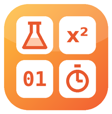
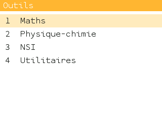
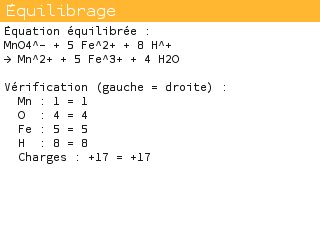
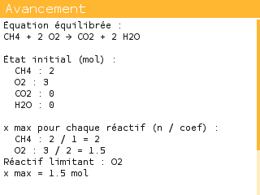
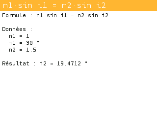
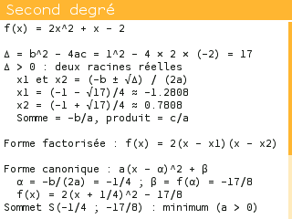
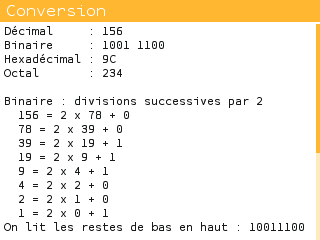

# Outils — application pour NumWorks N0120

> **Branche `v0120`** : version compilée pour la **N0120** (les calculs en `double` sont faits par le processeur, donc plus rapides). Elle **ne fonctionne pas sur N0110/N0115** : pour celles-ci, prendre `release/outils.nwa` de la branche principale.

Fait par **Caraito**.

Une application « boîte à outils » pour le lycée (niveau première), qui s'installe **à côté** du système officiel de la calculatrice :

Le menu principal a quatre parties :

| Partie | Contenu |
|---|---|
| **Maths** | **Second degré** avec étapes (Δ, racines exactes comme `(-1 - √17)/4`, formes factorisée et canonique, sommet, signe) ; **suites** arithmétiques et géométriques (terme général, somme, variation). |
| **Physique-chimie** | **Chimie** : équilibrage d'équations (parenthèses, crochets, hydrates, ions, électrons), **oxydoréduction** (couple trouvé automatiquement, demi-équations, équation bilan), **tableau d'avancement** (réactif limitant, x max, état final), **masse molaire** d'une formule, **quantité de matière** (n = m/M, C = n/V, Cm = m/V, dilution). **Physique** : **formules à trous**, on remplit toutes les cases sauf une et l'inconnue est calculée (mécanique, électricité, ondes et lumière, matière et fluides : 20 formules). |
| **NSI** | Conversions de bases avec étapes, addition / soustraction posées avec retenues, complément à 2, nombres à virgule IEEE 754, entraînement noté. |
| **Utilitaires** | **Chronomètre** avec tours, **minuteur** avec alerte visuelle, **nombres aléatoires** (intervalle, sans doublon, dés, pile ou face, mélange), **batterie** (pourcentage estimé, état de charge, temps restant mesuré). |

  
  

*(Captures prises dans le simulateur officiel NumWorks.)*

---

## Pourquoi une application et pas un « OS custom » ?

Depuis Epsilon 16, NumWorks **verrouille** la N0110 : à la mise à jour, un programme de démarrage est installé qui refuse tout système non officiel. Une calculatrice en **24.10.0 est verrouillée**. La déverrouiller demanderait une manipulation matérielle risquée (Raspberry Pi Pico).

Les **applications externes** (fichiers `.nwa`), elles, sont prévues par NumWorks : on les installe depuis leur site officiel, **sans rien modifier au système**. C'est ce que fait ce projet. Aucun risque d'abîmer la calculatrice.

---

## Installer l'application

1. Télécharger le fichier [`release/outils.nwa`](release/outils.nwa) (bouton « Download raw file » sur GitHub).
2. Sur un ordinateur, ouvrir **https://my.numworks.com/apps** avec **Chrome ou Edge** (Firefox et Safari ne savent pas parler à la calculatrice en USB).
3. Brancher la calculatrice en USB, l'allumer : l'écran « CALCULATRICE CONNECTÉE » s'affiche.
4. Suivre le site : choisir le fichier `outils.nwa`, puis installer.
5. L'application **Outils** apparaît à la fin de l'écran d'accueil.

> ⚠️ Le site **remplace** les applications externes déjà installées. Si d'autres applications sont installées, les ajouter toutes en même temps dans le site.

### Ce qu'il faut savoir

- Les applications externes sont **cachées en mode examen**, puis reviennent quand on quitte le mode examen.
- Un **reset** de la calculatrice (bouton au dos) **efface** les applications externes : il suffit de la réinstaller.
- Les scripts Python, les réglages et le reste de la calculatrice ne sont pas touchés.

---

## Revenir à la calculatrice d'origine

L'application ne modifie pas le système officiel : la calculatrice **est toujours sous l'OS d'origine** (Epsilon). Selon ce que tu veux faire :

### Supprimer l'application

Au choix :
- appuyer sur le bouton **RESET** au dos avec un trombone : les applications externes sont effacées. ⚠️ Un reset efface aussi les données non sauvegardées (scripts Python, listes…). Sauvegarde d'abord tes scripts sur https://my.numworks.com.
- ou repasser par **https://my.numworks.com/apps** et installer une liste d'applications vide (ou sans `outils.nwa`).

### Remettre la calculatrice « comme neuve » (mise à jour officielle)

1. Sauvegarder tes scripts Python sur https://my.numworks.com (ils seront perdus sinon).
2. Se connecter à son compte sur **https://my.numworks.com** avec Chrome ou Edge, calculatrice branchée.
3. Dans le menu sous son nom, choisir **Mise à jour**, puis suivre les étapes : la dernière version officielle d'Epsilon est réinstallée. Ne pas débrancher avant la fin. (Guide officiel : https://www.numworks.com/support/connect/update)

### Si la calculatrice ne démarre plus (mode de secours)

Très improbable avec une simple application, mais au cas où :
1. D'abord, un simple **RESET** (bouton au dos, avec un trombone).
2. Si ça ne suffit pas : brancher la calculatrice en USB, **maintenir la touche 6**, appuyer sur **RESET** au dos, puis **relâcher la touche 6**. L'écran reste noir et la LED s'allume : c'est le mode de récupération.
3. Suivre la procédure officielle : https://www.numworks.com/support/connect/rescue

---

## Mode d'emploi

### Touches générales

| Touche | Action |
|---|---|
| Flèches haut / bas | Se déplacer dans un menu, changer de champ, faire défiler un résultat |
| Flèches gauche / droite | Page précédente / suivante dans un long résultat |
| Chiffres 1 à 6 | Choisir directement un élément du menu |
| OK | Valider / champ suivant |
| EXE | Calculer (depuis n'importe quel champ) / relancer un tirage |
| Effacer (⌫) | Effacer le dernier caractère (shift + effacer : vider le champ) |
| Retour | Revenir en arrière ; depuis le menu principal, quitter |

**Taper des lettres :** `alpha` puis la touche donne une minuscule ; `shift`, `alpha` puis la touche donne une majuscule.

### Maths

**Second degré** : entrer a, b, c (0 si le terme est absent). Avec des coefficients entiers, les racines sont données sous forme exacte (fractions, racines carrées simplifiées), sinon en décimal.

**Suites** : entrer u0, la raison (r ou q) et n. L'outil donne u(n), la somme u0 + … + u(n), le sens de variation et les premiers termes.

### Physique-chimie

#### Chimie

**Équilibrer une équation** : on remplit deux champs : **Réactifs** et **Produits**, avec des espèces séparées par `+`.

| Écriture | Exemple |
|---|---|
| Simple | `CH4+O2` |
| Parenthèses / crochets | `Ca(OH)2`, `K4[Fe(CN)6]` |
| Hydrate (point) | `CuSO4.5H2O` |
| Ion : `^`, charge, signe | `Fe^3+`, `SO4^2-`, `Cl^-` (touche puissance pour `^`) |
| Électron | `e^-` |

Les symboles commencent par une majuscule (`Co` = cobalt, `CO` = monoxyde de carbone).

**Tableau d'avancement** : mêmes champs Réactifs / Produits (partagés avec l'équilibrage), plus **n init (mol)** : les quantités initiales dans l'ordre des espèces, **séparées par des virgules** (`2, 3`). Les produits non indiqués valent 0. Les décimales s'écrivent avec la touche point (`0.5`).

**Masse molaire** : taper une formule (`C6H12O6`, `Ca(OH)2`, `CuSO4.5H2O`). Masses atomiques de référence (H = 1,008 ; C = 12,011 ; O = 15,999…), donc le résultat peut différer légèrement d'un manuel qui arrondit (H = 1 ; C = 12 ; O = 16).

**Quantité de matière** : choisir la relation, remplir toutes les cases **sauf celle à calculer** (laissée vide). Dans `n = m / M`, la case M accepte aussi une formule (`H2O`). Pour la dilution, V1 et V2 sont dans la même unité.

**Oxydoréduction** (milieu acide) :
- **Demi-équation** : taper une espèce (`MnO4^-`, `Fe^2+`, `CH3CH2OH`…) et laisser « Conjuguée » vide : le couple est trouvé dans la table et la demi-équation est équilibrée avec H⁺, H₂O et e⁻ (`MnO4^- + 8 H^+ + 5 e^- = Mn^2+ + 4 H2O`). Si l'espèce appartient à plusieurs couples (Fe²⁺, H₂O₂), toutes les demi-équations sont données. Pour un couple absent de la table, taper aussi l'espèce conjuguée.
- **Équation bilan** : taper les deux réactifs. L'outil identifie l'oxydant et le réducteur (si plusieurs couples sont possibles, il choisit la réaction favorisée d'après les potentiels standard), écrit les demi-équations avec leurs coefficients puis l'équation bilan.
- **Couples connus** : les 30 couples de la table, avec leur potentiel standard E°.

#### Physique

Dans Physique-chimie, choisir **Formules de physique**, puis le thème.

Choisir un thème, puis une formule. **Remplir toutes les cases sauf celle à calculer** (laissée vide), puis EXE.
- Les unités sont indiquées à côté de chaque case (unités du système international, sauf mention contraire).
- Les angles sont en degrés. Pour Snell-Descartes, si le calcul demande sin > 1, l'outil signale la réflexion totale.
- Lentilles : les distances sont algébriques (OA est négatif quand l'objet est avant la lentille).
- Les grands et petits nombres s'écrivent avec la touche ×10^x : `6.67e-11`.
- La constante G = 6,674·10⁻¹¹ est intégrée ; g est prérempli à 9,81 N/kg (modifiable).

### NSI

- **Conversion de bases** : choisir la base de départ ; affiche les 4 bases et la méthode (divisions successives, puissances, groupes de 4 / 3 bits). Jusqu'à 32 bits.
- **Addition / soustraction** : posées comme sur papier, avec les retenues et la vérification en décimal.
- **Complément à 2** : décimal vers binaire (méthode « inverser + 1 ») et l'inverse. Le nombre de bits va de 2 à 32.
- **Flottants (IEEE 754)** : décompose un nombre en signe / exposant / mantisse sur 32 bits et montre l'erreur d'arrondi (ex : `0.1`).
- **Entraînement** : 10 questions au hasard (conversions, complément à 2), avec correction et astuce.

### Utilitaires

#### Chronomètre et minuteur

- Chronomètre : **OK** démarre / met en pause, **EXE** enregistre un tour, **Effacer** remet à zéro (en pause).
- Minuteur : entrer minutes et secondes puis **EXE**. **OK** = pause, **Effacer** = recommencer. À la fin, l'écran clignote jusqu'à l'appui sur une touche (la N0110 n'a pas de haut-parleur).

---

#### Batterie

La calculatrice ne mesure pas sa consommation : tout est **estimé** à partir de la tension de la batterie.
- **Pourcentage** : estimé d'après la tension (courbe typique d'une batterie lithium). Il est faussé pendant la charge.
- **Depuis l'ouverture** : baisse du pourcentage depuis l'ouverture de l'écran.
- **Temps restant mesuré** : calculé au rythme de baisse constaté, seulement si l'écran reste ouvert au moins 10 minutes et que le pourcentage a baissé. Plus on attend, plus c'est fiable.
- Pas d'historique sur plusieurs jours : une application externe ne peut pas garder de données entre deux ouvertures.

## Pour les développeurs

Code en C, environ 2 100 lignes, dans `src/` :

| Fichier | Rôle |
|---|---|
| `ui.c` / `ui.h` | Menus, formulaires, texte défilant, gros chiffres |
| `chimie.c` | Menu Physique-chimie, lecture des formules, équilibrage (élimination de Gauss en entiers), avancement, masse molaire, quantité de matière |
| `physique.c` | Formules à trous (aussi utilisées par « Quantité de matière ») |
| `maths.c` | Second degré, suites |
| `binaire.c` | NSI : conversions, opérations posées, complément à 2, IEEE 754, quiz |
| `outils.c` | Utilitaires : chronomètre, minuteur, aléatoire, batterie |
| `main.c` | Menu principal |

Prérequis : `arm-none-eabi-gcc` et Node.js (le SDK officiel [`nwlink`](https://www.npmjs.com/package/nwlink) est téléchargé tout seul).

```sh
make        # -> output/outils.nwa (à installer depuis my.numworks.com/apps)
make test   # vérifie les calculs (chimie, physique, maths, binaire, batterie) sur l'ordinateur
make sim    # -> output/outils.nwb, pour le simulateur officiel :
            #    epsilon.bin --nwb output/outils.nwb
```

Le simulateur se compile depuis [le code source d'Epsilon](https://github.com/numworks/epsilon) (`make PLATFORM=linux epsilon.bin`).

Sur la calculatrice, le SDK ne relie pas les fonctions batterie : `outils.c` les appelle directement par appel système (numéros repris d'Epsilon).

Les accents sont écrits normalement dans le code : `ui_str()` les convertit pour la police de la calculatrice, qui dessine « e » + accent combinant.

## Licence

Code sous [licence MIT](LICENSE) © 2026 Caraito : tu peux l'utiliser, le modifier et le partager, à condition de garder la mention de copyright.
